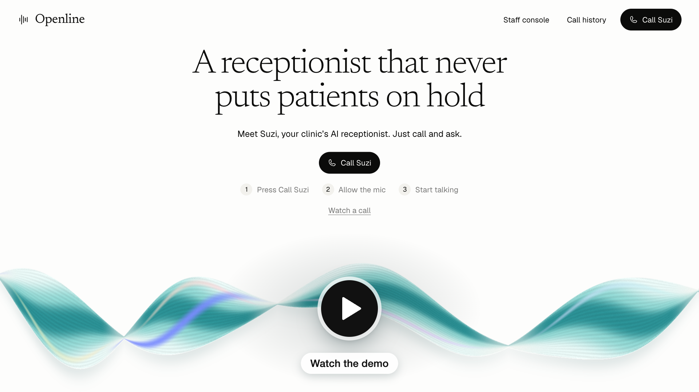
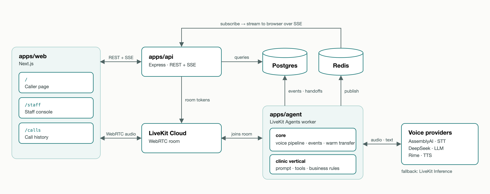

# Openline

*The clinic line that's always open.*

[](https://github.com/user-attachments/assets/c38ef3ed-dccd-437e-a835-bb86888af2e2)

Openline is a browser-based voice AI receptionist for a fictional clinic. Suzi, the agent, books, moves and cancels appointments, answers insurance questions and requests prescription refills. When a refill needs a clinician, she warm-transfers the caller to a human on the staff console.

> [!WARNING]
> Portfolio project with synthetic data. Don't enter real health information: transcripts are stored and providers receive call audio and text.

## Requirements

- Bun 1.3.13 and Node.js 18+
- Docker (for Postgres and Redis)
- A LiveKit Cloud project, plus AssemblyAI, DeepSeek and Rime API keys

## Installation

```bash
git clone https://github.com/deepanshuliv/openline.git
cd openline
bun install
```

## Configuration

Every app reads one root `.env`:

```bash
cp .env.example .env
```

Required: `LIVEKIT_URL`, `LIVEKIT_API_KEY`, `LIVEKIT_API_SECRET`, `NEXT_PUBLIC_LIVEKIT_URL`, `ASSEMBLYAI_API_KEY`, `DEEPSEEK_API_KEY`, `RIME_API_KEY`, `DATABASE_URL`, `REDIS_URL`. Optional settings (models, fallbacks, turn-taking, transfer timeout, ports) are listed in `.env.example` and validated in each app's `src/env.ts`.

## Quick start

```bash
docker compose up -d postgres redis
bun run db:migrate
bun run db:seed
bun run dev                   # web :3000, api :4000, agent worker
```

Open `http://localhost:3000`, click **Call Suzi**, allow the microphone and press **OK**. For the refill scenario, accept the transfer at `http://localhost:3000/staff`.

## Demo scenarios

| Scenario | Say you are | What happens |
| --- | --- | --- |
| Book | Maria Gonzalez, DOB March 14, 1985 | Verifies identity, offers open slots, books one. |
| Reschedule / cancel | James Carter, DOB Nov 2, 1972 | Moves a follow-up, cancels a physical. |
| Insurance | Priya Shah, DOB July 21, 1990 | Quotes copay, deductible and coverage from the active plan. |
| Refill + transfer | Robert Chen, DOB May 9, 1958 | Sends lisinopril to the pharmacy; lorazepam is controlled, so it queues a nurse transfer. |

## Architecture



- **Agent.** A vertical-agnostic core (`apps/agent/src/core`) runs the voice pipeline, call phases, events and warm transfer. The clinic vertical (`verticals/clinic`) adds the prompt, tools and rules. Each provider falls back to LiveKit Inference when it fails.
- **Events.** Every call event is written to Postgres and published on Redis. The API replays and streams them over SSE to the call history and staff console.
- **Guardrails.** Eligibility and refill decisions are plain functions in `packages/shared`, not LLM output. Patient tools refuse until identity is verified. The model only sees slot handles like `S1`, so it can't invent times. A partial unique index stops double-booking.

To add a vertical, implement `Vertical` in `apps/agent/src/core/Vertical.ts` and point `apps/agent/src/entry.ts` at it.

## API

| Method | Route | Purpose |
| --- | --- | --- |
| `POST` | `/api/calls/session` | Create a call and a caller LiveKit token |
| `GET` | `/api/calls`, `/api/calls/:id` | Call list and detail |
| `GET` | `/api/calls/:id/events/stream` | SSE call events |
| `GET` | `/api/handoffs/stream` | SSE staff queue |
| `POST` | `/api/handoffs/:id/accept` | Claim a transfer (409 if taken) |
| `POST` | `/api/handoffs/:id/complete` | End a transferred call |
| `GET` | `/api/metrics/latency` | Per-stage latency over recent calls |

Also: `GET /health`, `/api/calls/:id/events`, `/api/providers`, `/api/patients/:id`, `/api/handoffs`.

## Testing

```bash
bun run test                  # needs Postgres + Redis running and seeded
bunx turbo run check-types
bun run lint
```

Live provider checks (cost money) run from `apps/agent`: `bun run smoke`, `bun run evals`, `bun run live-call`.

## License

No license file is included in this repository.
